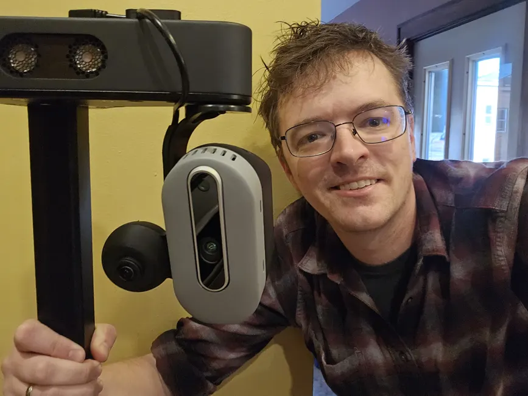

I’m a robotics researcher in Pittsburgh. I’m interested in what happens when a robot leaves the lab and someone asks it to do an ordinary thing, like finding a mug in a kitchen it’s never seen. At Agility Robotics, I lead a team studying how humanoids learn to move and manipulate objects from demonstrations and reinforcement learning.

At Meta FAIR, we built [HomeRobot](https://ovmm.github.io/) so researchers could test the same household task in simulation and on a physical robot. With [OK-Robot](https://github.com/ok-robot/ok-robot), we tried picking up and moving objects in ten real homes. Later, at Hello Robot, I led development of [Stretch AI](https://github.com/hello-robot/stretch_ai) so other people could run experiments like these on their own Stretch.

<figure>
  
  <figcaption>With my Stretch mobile manipulator.</figcaption>
</figure>

I write [It Can Think](/writing/) and co-host [RoboPapers](/podcast). Interviewing the people who built a system is often the best way to learn which experiment changed their minds.

[Résumé](/resume/) · [Papers](/papers) · [X / Twitter](https://x.com/chris_j_paxton) · [Email me](mailto:chris.paxton.cs@gmail.com)

## News and links
{: #news-and-links}

- **November 2026 · Learning from demonstrations.** Ruijie He and I spoke with Yuchen Zhou and Jiayuan Mao about why a simple regression policy can compete with flow matching. [RoboPapers episode 117](https://robopapers.substack.com/p/ep117-residual-modeling-closes-the)
- **October 2026 · The European Physical AI Summit.** In Munich I discussed what it would take for robotics to have its own “ChatGPT moment.” [MicroAGI’s account of the summit](https://www.microagi.ai/articles/european-physical-ai-summit)
- **September 2026 · 100 episodes of RoboPapers.** Our first hundred conversations are searchable by guest, paper, and topic. [Explore the episode archive](https://robopapers100.com/)
- **April 2026 · World models.** Jason Ma and I joined Encord to discuss how robots can use predictions about the world for training and evaluation. [Panel recap](https://encord.com/blog/world-models-webinar-recap/)
- **2025 · GraphEQA at CoRL.** Can a robot walk into a kitchen and tell you whether there’s a blue pan on the stove? Our paper uses a 3D scene graph to help the robot decide where to look. [Watch the Stretch experiment](https://saumyasaxena.github.io/grapheqa/) · [Read the paper](https://proceedings.mlr.press/v305/saxena25a.html)

Earlier press, awards, and project announcements

* [Multiple Magicbots](https://spectrum.ieee.org/video-friday-multiple-magicbots) including [Stretch AI](https://github.com/hello-robot/stretch_ai/) in the video roundup - IEEE Spectrum
  * [Hello Robot’s Stretch AI toolkit explores embodied intelligence](https://www.therobotreport.com/stretch-ai-toolkit-explore-embodied-intelligence/) - The Robot Report
  * [Stretch AI launch and the Chinese perspective of AI and humanoid robots](https://robotsandstartups.substack.com/p/stretch-ai-launch-and-chinese-perspective) - on Robots & Startups by Andrea Keay
  * [AI models let robots carry out tasks in unfamiliar environments](https://www.technologyreview.com/2024/09/20/1104233/ai-models-let-robots-carry-out-tasks-in-unfamiliar-environments) - MIT Technology Review
  * [How LLMs are Ushering In A New Era of Robotics](https://venturebeat.com/ai/how-llms-are-ushering-in-a-new-era-of-robotics/) - VentureBeat
  * [This robot can tidy a room without any help](https://www.technologyreview.com/2024/02/01/1087445/this-robot-can-tidy-a-room-without-any-help/) - MIT Technology Review
  * [Meta’s OK-Robot performs zero-shot pick-and-drop in unseen environments](https://venturebeat.com/automation/metas-ok-robot-performs-zero-shot-pick-and-drop-in-unseen-environments/) - VentureBeat
  * [NeurIPS 2023 HomeRobot: Open Vocabulary Mobile Manipulation (OVMM) Challenge](https://aihabitat.org/challenge/2023_homerobot_ovmm/) - AI Habitat
  * [Best paper finalist for SORNet - ICRA 2022 workshop on scaling robot learning](https://sites.google.com/view/icra22-srl) - ICRA 2022
  * SORNet nominated for best systems paper - CoRL 2021
  * [ALFRED Challenge results - CVPR 2021 - my team in 1st place](https://askforalfred.com/EAI21/) - ALFRED
  * [Maker’s Dozen: NVIDIA Researchers to Present Advances in Human-Robot Interaction and More at ICRA](https://blogs.nvidia.com/blog/2021/05/27/human-robot-interaction-research-icra) - NVIDIA
  * [BBC: Dog training technique helps robot learn and other news](https://www.bbc.com/news/av/technology-54645279) - BBC
  * [Teaching Robots through Positive Reinforcement](https://techcrunch.com/2020/10/26/teaching-robots-through-positive-reinforcement/) - TechCrunch
  * [New AI Trains Robots like Dogs](https://www.psychologytoday.com/us/blog/the-future-brain/202010/new-ai-trains-robots-dogs) - Psychology Today
  * [Dog Training Methods Help JHU Teach Robots to Learn New Tricks](https://cacm.acm.org/news/248390-dog-training-methods-help-jhu-teach-robots-to-learn-new-tricks/fulltext) - Communications of the ACM
  * [Robotics Reaps Rewards at ICRA](https://blogs.nvidia.com/blog/2020/05/29/dieter-fox-award-icra/) - NVIDIA
  * [NVIDIA Researchers Use AI to Teach Robots How to Improve Human-to-Robot Interactions](https://news.developer.nvidia.com/nvidia-researchers-use-ai-to-teach-robots-how-to-improve-human-to-robot-interactions/) - NVIDIA
  * [NVIDIA researchers use AI to teach robots how to hand objects to humans](https://venturebeat.com/2020/03/16/nvidia-researchers-use-ai-to-teach-robots-how-to-hand-objects-to-humans/) - VentureBeat
  * [Video Feature on the Seattle Robotics Lab](https://youtu.be/JT2viTz_0jU)
  * [NVIDIA Opens Robotics Research Lab in Seattle](https://news.developer.nvidia.com/nvidia-opens-robotics-research-lab-in-seattle/) - NVIDIA
  * [JHU Robotics Team Wins KUKA Innovation Award - MD](https://open.maryland.gov/blog/jhu-robotics-team-wins-kuka-innovation-award/) - Invited blog post by me
  * [The finalists of the Innovation Award 2016 have been selected](http://www.kuka-robotics.com/en/pressevents/news/NN_14012016_Innovative_Robot_applications_LBR_iiwa.htm) - KUKA
  * [KUKA Innovation Award 2016: Flexible Manufacturing Challenge](https://www.kuka.com/en-DE/Press/Event%20calendar/Hannover%20Fair%202016/kuka-innovation-award) - KUKA

## Patents

  * [Robot Control using Deep Learning](https://www.freepatentsonline.com/y2021/0252698.html)
  * [Imitation Learning System](https://patentimages.storage.googleapis.com/03/ba/22/79fd056c7334f5/US20210081752A1.pdf)
  * [Trajectory Generation using Temporal Logic and Tree Search](https://patentimages.storage.googleapis.com/35/dc/4e/6bf9a63a604604/US10133275.pdf)

## Invited talks

  * Connecting TAMP to the Real World ([video](https://www.youtube.com/watch?v=Zzi29kSKlcE)) - [RSS 2020 Workshop on Learning in Task and Motion Planning](https://ipvs.informatik.uni-stuttgart.de/mlr/rss2020Workshop/)
  * From Pixels to Task Planning and Execution - [IROS 2019 Workshop on Semantic Policies and Action Representations](https://sites.google.com/view/spar2019/speakers?authuser=0)
  * Building Reactive Task Plans for Real-World Robot Applications - [IROS 2019 Workshop on Behavior Trees for Robotic Systems](https://behavior-trees-iros-workshop.github.io/)

## Work Experience

  * Principal AI Scientist, Agility Robotics (2025–present)
  * Senior Lead, Embodied AI, Hello Robot (2024–2025)
  * AI Research Scientist, FAIR Labs (2022-2024)
  * Senior Robotics Research Scientist , NVIDIA (2020-2022)
  * Robotics Research Scientist, NVIDIA (2019-2020)
  * Postdoc at NVIDIA, in their Seattle Robotics Lab (2018-2019)
  * PhD student at Johns Hopkins University (2012-2018): representing tasks for collaborative robots 
  * Research Engineer Co-op at Zoox (2016-2017): planning for autonomous vehicles
  * Lockheed Martin (Summer 2012): security with mobile devices
  * US Army Research Lab (2010-2012): pedestrian detection
  * Johns Hopkins Applied Physics Lab: development of a zero gravity robot prototype

## Fun Stuff

  - [Gear Explainer](/gears/index.html) — Interactive notes and demos for spur, planetary, cycloidal, and harmonic reducers: meshing animations, backdrivability trade-offs, and real robot hardware examples.
  - [Infinite Quiz Machine](/quiz/index.html) - Take bunch of personality quizes procedurally generated by AI! Learn what kind of crustacean you are, what kind of door you are, and more!
  - [Labyrinth Generator](/labyrinth/index.html) - Procedurally generates worlds to explore using generative AI. Similar to the maze generator. Explore a strange city, a dark forest, or a crumbling castle.
  - [Boat vs Kraken Game](/boat_game/index.html) - Use the arrow keys to move the boat and avoid the kraken. Collect the coins for points. An experiment in using AI to generate a game.

## Education

In Spring 2018, I successfully defended my PhD in Computer Science at the Johns Hopkins University in Baltimore, Maryland. My PhD thesis is titled [Creating Task Plans for Collaborative Robots](https://jscholarship.library.jhu.edu/handle/1774.2/59196), and it covers both our CoSTAR system and the novel algorithms we have created for creating robots that can use expert knowledge to plan. I did my research in the [Computational Interaction and Robotics Lab](http://cirl.lcsr.jhu.edu/) with Greg Hager.

I did my undergraduate work at University of Maryland, College Park, where I got a BS in Computer Science with a minor in Neuroscience, where I graduated with University honors as a part of their Gemstone program for young researchers.

During Spring 2016, I led the JHU team for the KUKA Innovation Award competition. I led our successful entry into the KUKA innovation award competition with our updated [CoSTAR system](http://cpaxton.github.io/costar_stack/). CoSTAR integrates a user interface, perception, and abstract planning to create robust task plans. We have since used CoSTAR on a wide variety of problems.

<figure>
  
  <figcaption>KUKA award finalists at KUKA College Gersthofen in December 2015.</figcaption>
</figure>

## Teaching Experience

  * Taught EN.500.111 __"HEART: Making Robots our Friends: Technologies for Human-Robot Collaboration"__ in Fall 2015.
  * Teaching assistant for EN.600.436/636: __"Algorithms for Sensor Based Robotics"__, Spring 2015
